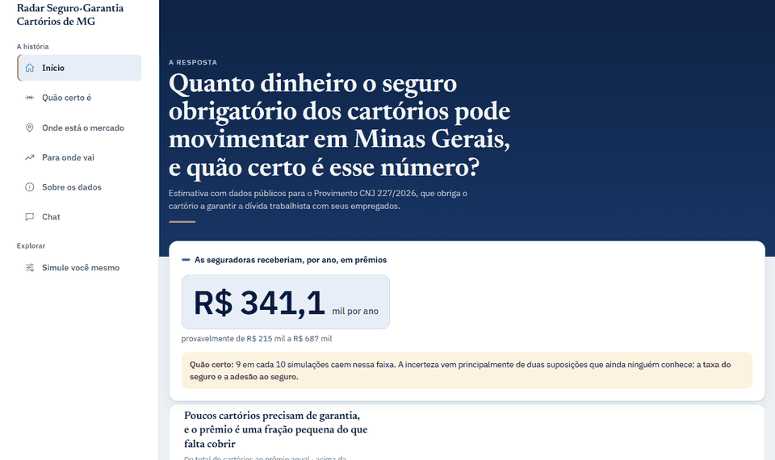
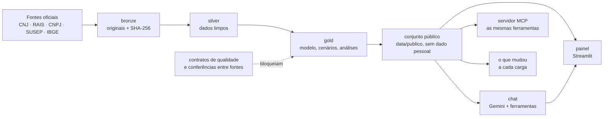

# Radar Seguro-Garantia Cartórios

[](https://github.com/luccaamp/radar-seguro-cartorio/actions/workflows/ci.yml)

**Quanto dinheiro o seguro obrigatório dos cartórios pode movimentar, e quão certo é esse número?** O Provimento CNJ 227/2026 obriga parte dos cartórios a garantir a dívida trabalhista com seus empregados. Este projeto estima esse mercado com dados públicos oficiais, mostra a incerteza de cada número e deixa qualquer pessoa conferir as contas: um painel, um simulador e um chat que só responde com número tirado dos dados, com a fonte.

**Painel público:** **[radar-seguro-cartorio.streamlit.app](https://radar-seguro-cartorio.streamlit.app)** (Streamlit Community Cloud, modo demonstração com o conjunto público; a primeira visita pode levar alguns segundos para acordar o app). Hoje cobre **Minas Gerais**; os outros estados entram nas próximas fases ([`docs/plano_projeto.md`](docs/plano_projeto.md)).


<details><summary>Tour pelas páginas (GIF)</summary>



</details>

> **Nunca ouviu falar de seguro-garantia nem do Provimento 227? Comece por [`docs/entenda_o_projeto.md`](docs/entenda_o_projeto.md):** o problema, o básico de seguro-garantia, as perguntas que o projeto responde e um glossário, em linguagem simples.

## O que o painel responde (MG, carga de 2026-11-07)

| Pergunta | Resposta | Origem |
|---|---|---|
| Quantos cartórios ativos e quantos empregados CLT? | 2.525 e 12.134 | dado público (CNJ) |
| Quantos são obrigados a ter a garantia? | ≈ 1.121 | regra do Prov. 227 sobre a arrecadação do CNJ |
| Qual a dívida trabalhista dos obrigados? | R$ 238,1 milhões | modelo sobre a RAIS |
| Quantos não teriam bens para cobri-la, e quanto falta? | ≈ 148, com R$ 34,1 milhões de déficit | modelo |
| Quanto as seguradoras receberiam por ano? | **R$ 341,1 mil** (faixa provável de R$ 215 a 687 mil) | modelo, com 2 suposições sem fonte pública (taxa e adesão) |

O painel tem a história em 5 páginas (o número com os 6 indicadores principais, quão certo ele é, onde está o mercado, para onde vai e de onde vêm os dados), o mapa clicável dos 851 municípios com cartório (déficit em R$, % de obrigados ou % na Classe 3; o clique abre os cartórios do município, pelo CNS), um simulador ("e se a taxa fosse 3%?", "e se o STF suspender a obrigação?") e o chat. Os dez números oficiais, com os extremos, estão em [`docs/ESTADO_ATUAL.md`](docs/ESTADO_ATUAL.md#números-de-referência).

## Como funciona



- **Pipeline em camadas** (DuckDB): o bronze guarda os originais com o hash; o silver limpa; o gold calcula o modelo (premissas versionadas em `config/`, cada uma com fonte ou marcada `fonte: suposição`). Um contrato de qualidade violado interrompe a carga.
- **Conjunto público** (`data/publico/`, < 1 MB, no git): as tabelas que o painel lê, auditadas para que nenhum nome nem CPF de pessoa física saia (D-038).
- **Chat que não inventa número:** o modelo (Gemini, nível gratuito) só responde chamando ferramentas que leem as mesmas tabelas do painel, e cita a fonte. Quando o dado não existe, diz que não encontrou.
- **Servidor MCP:** as mesmas 5 ferramentas do chat, para qualquer cliente MCP (Claude Desktop, Claude Code, IDEs) consultar os números com a fonte, de um clone, sem chave nem internet: `uv run python -m src.agent.servidor_mcp` (no Claude Code: `claude mcp add radar -- uv run --directory <pasta do clone> python -m src.agent.servidor_mcp`). Só lê o conjunto público; implementado sem dependência nova ([`src/agent/servidor_mcp.py`](src/agent/servidor_mcp.py)).
- **O que mudou a cada carga:** um agente compara o conjunto publicado antes com o novo (os 10 números, as datas das fontes, as tabelas e as colunas) e o Gemini resume em 2 a 4 frases; cada número do resumo é conferido no relatório, e um número sem apoio descarta o resumo ([`scripts/o_que_mudou.py`](scripts/o_que_mudou.py); a última comparação em [`docs/o_que_mudou.md`](docs/o_que_mudou.md)).
- **Tudo gratuito e reproduzível:** de um clone, `uv sync` e o painel abre com os números da carga oficial; com `data/completo/` o gold é recalculado e confere com o publicado pelo hash.

## Qualidade medida

| Medida | Resultado | Onde |
|---|---|---|
| Acerto do chat no gabarito congelado (52 perguntas) | **96%** com ferramentas (intervalo de 95%: 87% a 99%); 23% com as normas no prompt; 17% sem nada | [`eval/resultado_avaliacao.md`](eval/resultado_avaliacao.md) |
| Avaliação do chat toda semana, com a API real | [](https://github.com/luccaamp/radar-seguro-cartorio/actions/workflows/avaliacao-chat.yml) verde = meta cumprida (acerto ≥ 85%, nenhum número inventado nas armadilhas); o relatório fica no resumo de cada execução | [`.github/workflows/avaliacao-chat.yml`](.github/workflows/avaliacao-chat.yml) |
| Ganho das ferramentas, nas mesmas perguntas | +78,8 pontos sobre o modelo sozinho (intervalo: +66,4 a +91,3) | idem, seção "Margem de erro" |
| Número inventado nas perguntas-armadilha | nenhum | idem |
| Contratos de qualidade na carga | 109 checagens; nenhum erro violado | página "Sobre os dados" |
| Testes a cada pull request (GitHub Actions) | suíte padrão (462 testes, entre eles os do JavaScript do mapa e do botão de tema, e os do servidor MCP), o mapa num navegador de verdade (4) e o modo completo com os dados reais | [`.github/workflows/ci.yml`](.github/workflows/ci.yml) |
| Cobertura dos testes em `src/` | 71% das linhas (indicador, não meta: cobertura alta não garante teste bom; Inozemtseva e Holmes, ICSE 2014) | `uv run pytest --cov=src` |
| Acessibilidade (axe) nas 7 páginas | 0 falhas do código do projeto | `scripts/acessibilidade.py` |
| Custo | R$ 0 (níveis gratuitos, sem cartão) | [`CLAUDE.md`](CLAUDE.md) |

A margem de erro do chat segue Miller (2024, "Adding Error Bars to Evals", arXiv:2411.00640). Os contratos do gold seguem a ideia de "testes de unidade para dados" (Schelter et al., PVLDB 2018).

## Limitações

- **Estimativa de mercado, não avaliação de cartório:** só dados públicos e suposições declaradas; supõe a regra do Provimento como publicada (a ADI 8015 no STF pode mudá-la).
- **Classe aproximada:** a arrecadação publicada pelo CNJ não é exatamente a receita bruta da norma.
- **Dívida trabalhista:** a RAIS não traz a maior remuneração fixa nem as verbas de convenção coletiva.
- **Taxa e adesão ao seguro:** nenhuma fonte pública as traz; por isso a faixa provável é larga.
- **Um estado só**, por enquanto.

## Como o projeto foi feito

O projeto foi construído dirigindo uma IA (Claude Code), com as regras em [`CLAUDE.md`](CLAUDE.md), num desenvolvimento guiado por especificação: a [`docs/SPEC.md`](docs/SPEC.md) diz o que fazer, o [`docs/plano_projeto.md`](docs/plano_projeto.md) divide em fases com um "pronto quando" cada, e nada entra sem teste e decisão registrada. Cada decisão está em [`docs/decisoes.md`](docs/decisoes.md), cada passo em [`docs/diario.md`](docs/diario.md) e cada erro da IA, com a causa e a correção, em [`docs/erros_ia.md`](docs/erros_ia.md). A etapa atual está no [`docs/ESTADO_ATUAL.md`](docs/ESTADO_ATUAL.md); a especificação, no [`docs/SPEC.md`](docs/SPEC.md).

## Como rodar

Requisitos: Git e o [`uv`](https://docs.astral.sh/uv/) (ele instala o Python 3.12 sozinho). Nada pago, nenhuma conta em nuvem.

**Testes automáticos (CI, D-072, D-073 e D-083):** a cada pull request para a `main` e a cada push nela, o GitHub Actions roda três jobs ([`.github/workflows/ci.yml`](.github/workflows/ci.yml)): `ruff` e a suíte padrão (`uv run pytest`, sem chave do Gemini e sem internet, com os testes do JavaScript do mapa pelo `node --test`); depois, em paralelo, o mapa clicável num Chromium de verdade (`uv run pytest -m navegador`) e o modo completo da seção 1b (instala `data/completo/`, recalcula o gold) com os testes dos dados reais.

### 1. Ver o painel (≈ 2 min)

O repositório já traz o **conjunto público** (`data/publico/`, < 1 MB): as tabelas agregadas e auditadas que o painel lê. Sem baixar mais nada, o painel abre em **modo demonstração**, com os números da carga oficial.

Windows (PowerShell):
```powershell
powershell -ExecutionPolicy ByPass -c "irm https://astral.sh/uv/install.ps1 | iex"   # instala o uv (uma vez)
git clone https://github.com/luccaamp/radar-seguro-cartorio.git
cd radar-seguro-cartorio
uv sync
uv run streamlit run app/Inicio.py
```

Linux / macOS:
```bash
curl -LsSf https://astral.sh/uv/install.sh | sh   # instala o uv (uma vez)
git clone https://github.com/luccaamp/radar-seguro-cartorio.git
cd radar-seguro-cartorio
uv sync
uv run streamlit run app/Inicio.py
```

O navegador abre em `http://localhost:8501`. No modo demonstração:
- o Simulador recalcula as premissas de seguro, déficit e cenário do STF livremente, e as do passivo numa grade pré-calculada (uma por vez);
- "Salvar cenário" fica desativado (com o banco, os cenários vão para `data/painel_estado.json`; ver a seção 5).

Os testes também rodam sem dados reais: `uv run pytest`.

### 1b. Modo completo direto do repositório (D-050)

O repositório também traz `data/completo/` (≈ 13 MB): o silver da carga oficial, sem dado pessoal (D-031); o gold completo (inclusive as tabelas `interno_*`); e o CSV do BI do CNJ comprimido (de onde vêm a capacidade de pagar e a pergunta 9), com o SHA-256 de cada arquivo em `data/completo/manifesto.json`. Sem baixar nada de Release (os mesmos comandos no Windows e no Linux/macOS):

```
uv run python scripts/exportar_completo.py --instalar   # silver em data/silver/ e o CSV do BI no bronze, com hash conferido
uv run pipeline.py --a-partir-de silver                 # recalcula o gold e grava data/radar.duckdb (≈ 7 min)
uv run streamlit run app/Inicio.py
```

O painel abre em modo completo (Simulador sem grade e "Salvar cenário" ativo). O gold recalculado tem o mesmo conteúdo de `data/completo/gold/`. Quem mantém a carga regrava a pasta com `uv run python scripts/exportar_completo.py` depois de cada carga oficial.

### 2. Recalcular com os dados públicos

Baixa o silver da carga (dados limpos das fontes oficiais, ≈ 3 MB, sem login) e recalcula o gold com o código do repositório. Os comandos são os mesmos no Windows e no Linux/macOS:

```
uv run python scripts/baixar_dados.py --nivel publico --camadas silver --carga 2026-10-19
uv run pipeline.py --a-partir-de silver
uv run pytest tests/test_publico.py
uv run streamlit run app/Inicio.py
```

O que cada comando faz:
- `baixar_dados.py` confere o hash de cada arquivo e instala em `data/silver/`;
- `pipeline.py --a-partir-de silver` recalcula o gold;
- `tests/test_publico.py` compara o gold recalculado com o conjunto público, pelo hash de conteúdo;
- `streamlit run` abre o painel com o seu banco (rodapé: "recalculada com os dados públicos").

O teste deve passar: mesmo silver + mesmo código = mesmos números.

### 3. Reproduzir do zero (coleta)

```
uv run pipeline.py ingest
uv run pipeline.py --a-partir-de bronze
```

- **O que é baixado:** o `ingest` baixa das fontes oficiais cerca de 8,4 GB, a maior parte do pacote mensal de CNPJ da Receita (6,8 GB) e dos microdados da RAIS (0,9 GB). Ele também extrai cerca de 6 GB da RAIS. Reserve cerca de 16 GB de disco.
- **Onde ficam os originais (D-032):**
  - os originais grandes vão para uma pasta **fora do projeto**: `C:\radar_arquivo\bronze_originais` no Windows, `~/radar_arquivo/bronze_originais` no Linux/macOS;
  - a pasta se configura em `config/pacotes.yaml` ou na variável `RADAR_ORIGINAIS`;
  - o bronze do projeto (`data/bronze`, ≈ 144 MB) guarda só os extratos que o silver lê e um `original.json` por fonte, com URL oficial, SHA-256, tamanho e hora de coleta de cada original.
- **Procedência no git (D-070):** o bronze não vai para o git nem para o Release público, porque tem nome de pessoa (D-030). Os registros de coleta dele (`original.json`, `_metadados.json` e `*.meta.json`: URL oficial, SHA-256, tamanho e hora de coleta, sem o dado) vão em `data/procedencia/`, no mesmo caminho do bronze. Para conferir uma coleta nova contra a oficial, compare os SHA-256. Quem mantém a carga regrava a pasta com `uv run python scripts/exportar_procedencia.py` depois de cada coleta.
- **Tempo:** depende da conexão. A 30 Mbit/s, só o download leva cerca de 40 minutos. O pipeline leva cerca de 1 minuto.
- **Snapshots:** o `ingest` avisa quando há snapshots novos. Para usá-los, atualize as datas em `config/escopo.yaml`.

**As fontes se atualizam: os números podem diferir dos da carga oficial.** Para comparar, use os hashes do manifesto: `uv run pytest tests/test_publico.py` mostra quais tabelas mudaram. O `data/publico/manifesto.json` traz a data de referência e o SHA-256 do arquivo bruto de cada fonte.

**Opcional (BI do CNJ):** as conferências arquivadas da Fase 1 (`scripts/arquivo/verificacao_fase1/`) usam um CSV exportado manualmente do painel de BI do CNJ (`atos_arrecadacoes_custeio_e_repasse.csv`; ver `docs/historico/verificacao_final_fase1.md`). Sem ele, essas conferências avisam "arquivo ausente"; o pipeline e os totais de controle de `config/qualidade.yaml` não dependem dele. O CSV está no pacote de dados da equipe.

### 4. Equipe

Colaboradores convidados baixam qualquer camada (bronze, silver, gold completo, banco) da mesma carga pelo repositório privado de dados. Veja [`CONTRIBUTING.md`](CONTRIBUTING.md).

**Testes com os dados reais** (`uv run pytest -m dados_reais`): com o modo completo (seção 1b), rodam os do painel, do chat, das análises e da coerência com `data/completo/` e `data/publico/`. Os que conferem a passagem bronze → silver (`test_nomes`, `test_rastreabilidade` e os extratos de `test_coletores`) precisam do bronze e são **pulados** com o motivo "bronze ausente": rodam para a equipe (pacote da equipe) ou para quem coletou do zero (seção 3).

### 5. Conferir o painel

O painel só **lê** o banco (`data/radar.duckdb`) e pode ser aberto direto, sem cópia: `uv run streamlit run app/Inicio.py`. Os cenários salvos no Simulador vão para `data/painel_estado.json`, fora do banco e do git (D-034). Com o painel aberto, o pipeline não roda: ele para no início e pede para fechar o painel.

Roteiro, com a carga 2026-10-28 (dados da coleta de 17 e 18/10, premissas v3, regra v2, nível base, regra do STF mantida):
- **Início:** 2.525 serventias, 12.134 empregados CLT, passivo R$ 311,9 mi (todas) e R$ 238,1 mi (obrigados), déficit R$ 34,1 mi, prêmio R$ 341,1 mil, teto teórico R$ 4,8 mi (238,1 mi × 2,0%).
- **Mercado:** os mesmos totais, ≈ 1.121 obrigadas e ≈ 148 com déficit. Um filtro (ex.: Classe 3) e um município (Belo Horizonte; um pequeno, como Santana do Paraíso, aparece com os números dele e a posição entre os 851, D-078).
- **Explorar → Simule você mesmo** (o Simulador, numa seção própria do menu; D-077): no padrão, 1.121, R$ 238,1 mi, 148, R$ 34,1 mi, IS R$ 17,1 mi, prêmio R$ 341,1 mil e a faixa por sorteio de R$ 215,0 a 687,1 mil (a da página "Quão certo é"). O atalho "E se a taxa fosse 3%?" leva o prêmio a R$ 511,6 mil; "E se o STF suspender a obrigação?" zera a demanda; "Voltar ao cenário base" desfaz. O tornado ao vivo mostra o que mais mexe no prêmio com os valores escolhidos. Salvar um cenário (no expansor do fim): ele aparece na tabela e continua lá depois de reabrir o painel.
- **Sobre os dados:** os 10 números, a data de referência de cada fonte, como foi calculado, a saúde dos dados (contratos e conferências entre fontes; no modo demonstração, a data e o commit do conjunto publicado) e as limitações. O detalhe das conferências (CNPJ × CNJ +15,8%, aviso; RAIS × CNJ +1,8%) está no chat.
- **Chat (D-060 a D-066):** usa o Gemini no **nível gratuito** do Google AI Studio, com o **faturamento desligado** (nunca cadastre cartão). Para ligar: crie uma chave em [aistudio.google.com/apikey](https://aistudio.google.com/apikey), copie o `.env.example` para `.env` e cole a chave em `GEMINI_API_KEY` (o `.env` fica fora do git; cada pessoa usa a própria chave). Passo a passo, com os comandos de Windows e WSL: `CONTRIBUTING.md`, seção "Chat com o Gemini". No Streamlit Community Cloud, a mesma variável vai em *Settings → Secrets*. A página tem duas abas: **Chat** e **Perguntas prontas** (16 perguntas por tema, respondidas direto pelas ferramentas, com os mesmos números, contas e fontes do painel). Sem a chave, sem internet ou com a cota esgotada, a aba Chat avisa que está indisponível e indica a outra aba (o motivo vai para o log). No link público, cada sessão faz até 20 perguntas ao modelo. Quando o dado não existe no painel, a resposta é "Não foi possível encontrar essa resposta nos dados do painel.". Medir a velocidade com a API real: `uv run python scripts/medir_latencia_chat.py --saida docs/qa/chat/latencia_depois.md`; capturas da página: `uv run python scripts/prints_chat.py --saida docs/qa/chat/interface_depois`. Não digite dados pessoais: no nível gratuito, o Google pode usar as conversas. Perguntas para testar: "qntos cartorio tem em minas?" (2.525), "Se a taxa fosse 3%, qual o prêmio do mercado?" (R$ 511,6 mil), "A garantia pode ser fiança bancária?" (sim, de banco S1 ou S2; Prov. 227, art. 13) e "Me explica o gráfico tornado" (a taxa do seguro é o que mais pesa). Nome de pessoa nunca aparece.
- **Avaliação do chat com a API real** (fora de `uv run pytest`, que nunca usa a API nem a internet): `uv run python scripts/avaliar_chat.py` compara as versões (a) sem ferramentas, (b) normas no prompt e (c) com ferramentas no gabarito congelado `eval/gabarito_chat.csv` (52 perguntas; meta: (c) com 85% de acerto e nenhum número inventado nas armadilhas). Pausa 15 s entre perguntas e guarda as respostas em `eval/respostas/`: se a cota acabar no meio, rode de novo depois, e só o que falta é perguntado. Relatório em `eval/resultado_avaliacao.md`. Teste rápido: `--versoes c --limite 5`.
- **Rodapé:** "Carga 2026-10-28 · dados completos" (ou "· demonstração" sem o banco). Num projeto em que a carga foi refeita sem instalar a Release, o rodapé continua com a data da Release instalada (`data/carga_atual.json`).

## Estrutura do projeto

```
app/                 painel Streamlit: "A história" (Início, Quão certo é, Onde está o mercado, Para onde vai, Sobre os dados, Chat) e "Explorar" (o Simulador); menu em app/Inicio.py; docs/painel/
config/              premissas e regras versionadas, com fonte
data/publico/        conjunto público versionado (tabelas agregadas e auditadas que o painel lê)
data/samples/        amostras mascaradas das fontes (Fase 0)
docs/                entenda o projeto (para leigos), estado atual, plano da etapa atual, SPEC, decisões, dicionário de dados, diário, erros da IA, publicação
docs/historico/      documentos de épocas anteriores: rodadas da Fase 1, viabilidade (Fase 0), pedidos por fase, ROADMAP e plano de qualidade (com INDICE.md)
docs/qa/analises/    gráficos da mineração de dados (PNG)
eval/                gabarito do chat e resultado da avaliação (scripts/avaliar_chat.py)
notebooks/           exploração e modelos, com as saídas (só leem o banco; regras no CONTRIBUTING.md, seção Notebooks)
scripts/             conjunto público, pacotes de dados, QA visual e acessibilidade, conversas
scripts/arquivo/     scripts de uso único da Fase 1
src/                 coleta, bronze→silver→gold, modelo, qualidade, conjunto público, pacotes, chat (agent, llm), painel (análises e interface)
tests/               suíte padrão, dados_reais e visual
pipeline.py          orquestrador: uv run pipeline.py --a-partir-de bronze|silver
```

Fora do git, só local: `data/bronze`, `data/silver`, `data/gold`, `data/radar.duckdb`, `data/painel_estado.json` (cenários salvos no painel, D-034), `conversas/` e `docs/qa/` (menos `docs/qa/analises/`, que vai para o git). Também ficam fora, e fora da pasta do projeto, os pacotes de dados (`C:\radar_pacotes`) e os originais grandes do bronze (`C:\radar_arquivo\bronze_originais`, D-032).

## Fontes

| Fonte | Link oficial | Data de referência da carga | Uso |
|---|---|---|---|
| CNJ / Justiça Aberta: cadastro, colaboradores e arrecadação das serventias | [justicaabertaapi.cnj.jus.br](https://justicaabertaapi.cnj.jus.br/v1/api/serventias) | cadastro e colaboradores: 2026-10-17; arrecadação: exercício 2025 (série até 2026-06-30) | serventias, empregados CLT, classe |
| RAIS / PDET (Ministério do Trabalho), microdados de vínculos | [ftp.mtps.gov.br/pdet/microdados/RAIS](ftp://ftp.mtps.gov.br/pdet/microdados/RAIS/2025/) | 2025-12-31 | salários e tempo de emprego |
| Receita Federal, CNPJ (dados abertos) | [arquivos.receitafederal.gov.br](https://arquivos.receitafederal.gov.br/public.php/webdav/Dados/Cadastros/CNPJ/) | 2026-10 | conferência de estabelecimentos |
| SUSEP, SES (seguro-garantia, ramos 0775 e 0776) | [www2.susep.gov.br](https://www2.susep.gov.br/redarq.asp?arq=BaseCompleta%2ezip) | 2026-08 | sinistralidade, comissão, market share |
| IBGE: municípios, população, malha, INPC e IPCA | [servicodados.ibge.gov.br](https://servicodados.ibge.gov.br/api/docs/) e [apisidra.ibge.gov.br](https://apisidra.ibge.gov.br/) | municípios vigentes em 2026-10-18; população 2026; malha 2022; índices até 2026-09 | regiões, mapa, correção salarial |

- **Termos de uso:** todos os dados são públicos, de acesso aberto. Os termos de uso são os de cada site acima: confira na fonte antes de reutilizar.
- **Publicação e proteção de dados (D-038):** é um estudo público, com dados públicos do governo; tudo pode ser público, inclusive as estimativas do modelo por cartório (os notebooks já as mostram, pelo CNS e pelo município). A única restrição: nenhum nome nem CPF de pessoa física. Desde a D-078, o conjunto público e o painel mostram todos os municípios com cartório, sem agregação.
- **Detalhe de cada fonte:** data de coleta, URL e SHA-256 estão em `data/publico/manifesto.json`; a data de referência, na página "Sobre os dados".

## Licença

Código sob a licença [MIT](LICENSE). Os dados seguem os termos de uso das fontes oficiais listadas acima.
